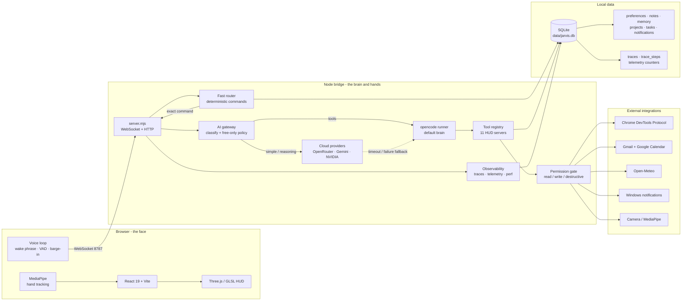
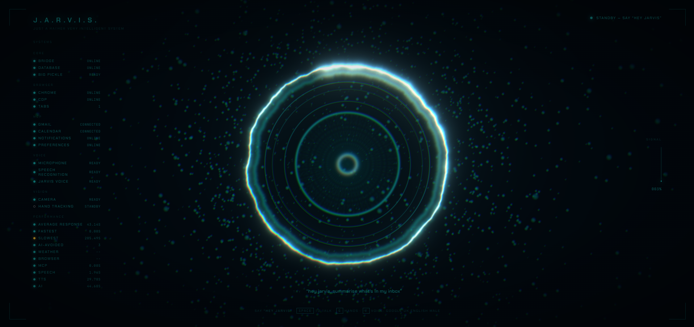

<div align="center">
  
</div>

<h1 align="center">J.A.R.V.I.S.</h1>

<p align="center"><strong>JUST A RATHER VERY INTELLIGENT SYSTEM</strong></p>

<p align="center">
  Personal AI assistant &nbsp;·&nbsp; Hybrid intelligence &nbsp;·&nbsp; Voice &nbsp;·&nbsp; Memory &nbsp;·&nbsp; Desktop automation
</p>

<p align="center">
  
  <a href="#architecture"></a>
  <a href="#installation"></a>
  <a href="#installation"></a>
  <a href="LICENSE"></a>
</p>

<p align="center">
  <a href="#overview">Overview</a> ·
  <a href="#feature-showcase">Features</a> ·
  <a href="#architecture">Architecture</a> ·
  <a href="#technology-stack">Stack</a> ·
  <a href="#installation">Installation</a> ·
  <a href="#roadmap">Roadmap</a> ·
  <a href="#development">Development</a>
</p>

<p align="center">
  <sub>Deep dives: <a href="docs/architecture.md">Architecture</a> · <a href="docs/installation.md">Installation</a> · <a href="SECURITY.md">Security</a> · <a href="CONTRIBUTING.md">Contributing</a> · <a href="CHANGELOG.md">Changelog</a></sub>
</p>

> **Lineage and credit.** This is an independent personal AI engineering project,
> evolved from the MIT-licensed [adewaskar/jarvis](https://github.com/adewaskar/jarvis)
> foundation by Aditya Dewaskar. The original interface, voice pipeline, bridge,
> and gesture work remain credited in [LICENSE](LICENSE) and in this README.
> JARVIS 2.0 adds a modular bridge, a provider-independent intelligence
> gateway, SQLite observability, and a stricter security boundary without
> replacing the working assistant.

---

## Overview

JARVIS is an evolving personal AI ecosystem, not a chat window with a theme
painted on it. The browser is the **face**: a React and Three.js holographic
interface with a boot sequence, reactor HUD, panels, orbits, diagnostics, voice,
and hand tracking. The Node bridge is the **brain and hands**: it owns the turn
lifecycle, the deterministic command router, the model gateway, the permission
gate, the tool registry, and the local database.

The design principle is **hybrid intelligence with deterministic fallbacks**:

- **Exact commands never wake a model.** Opening a site, switching tabs,
  checking the weather, reading today's calendar, or setting a reminder is
  handled by a strict fast router.
- **Tool-using turns go to the local brain.** The default brain is
  `opencode run --format json` on the free OpenCode Zen tier, with session
  continuation and generated HUD tools.
- **Conversation can use a cloud provider.** OpenRouter, Google Gemini, and
  NVIDIA NIM are optional adapters behind a free-first policy. A failed cloud
  call falls back to the local brain rather than failing the turn.
- **The machine stays in control.** The bridge binds to loopback only, secrets
  stay server-side, effectful tools are gated, destructive tools require a
  spoken confirmation, and observability stores metadata rather than prompts or
  replies by default.

The result is an assistant that can answer, remember, look, listen, drive a
browser, read mail and calendar data with the user's consent, schedule native
notifications, and explain its own service health — while remaining usable with
no paid API key and no cloud account.

---

## System Status

| Signal | Current state |
|---|---|
| **Development** | Active. JARVIS 2.0 architecture is in place; retrieval, routing, and reliability work continues. |
| **Default brain** | `opencode/big-pickle` via `opencode run`, effort `low` by default. Free Zen tier; network-backed, not local inference. |
| **Cloud intelligence** | Optional OpenRouter → Gemini → NVIDIA NIM chain. `AI_BILLING_MODE=free_only` by default. |
| **Interface** | React 19, TypeScript, Vite 8, Three.js, custom GLSL, framer-motion, Zustand. |
| **Voice** | Browser SpeechRecognition wake phrase, local energy VAD, barge-in, system/Kokoro/ElevenLabs TTS tiers. |
| **Memory** | Local SQLite in WAL mode at `data/jarvis.db`; preferences, notes, memory, projects, tasks, notifications, tabs, traces. |
| **Automation** | Chrome DevTools Protocol adapter; Gmail and Google Calendar through server-side OAuth; Windows notifications. |
| **Platform** | Windows first (launchers, notifications, Chrome CDP); the Node ESM bridge and web interface are cross-platform. |
| **License** | MIT. See [LICENSE](LICENSE). |

<div align="center">
  
</div>

## Feature Showcase

<table>
<tr>
<td width="50%" valign="top">
  
  <strong>Hybrid AI Intelligence</strong><br>
  <br><br>
  A deterministic fast router handles exact commands with no model call. The
  local opencode brain owns tool turns. An optional cloud chain adds OpenRouter,
  Gemini, and NVIDIA NIM for plain conversation, with timeout failover and an
  explicit local fallback. Free-only billing refuses unverified paid models.
</td>
<td width="50%" valign="top">
  
  <strong>Voice Assistant</strong><br>
  <br><br>
  Say “Hey Jarvis” and speak naturally. A local energy VAD detects speech and
  makes barge-in work; the browser recognizer handles the wake phrase. Speech
  output degrades cleanly through ElevenLabs, Kokoro, and the operating
  system’s own voice.
</td>
</tr>
<tr>
<td width="50%" valign="top">
  
  <strong>Persistent Memory</strong><br>
  <br><br>
  SQLite stores preferences, notes, facts, projects, and tasks. Memory and
  project search currently use `LIKE` ranking. FTS5/BM25 retrieval, metadata
  boosts, deduplication, and consolidation are designed but not yet shipped.
</td>
<td width="50%" valign="top">
  
  <strong>System Awareness</strong><br>
  <br><br>
  `/systems` and the `services_status` tool report bridge uptime, model, writes,
  browser reachability, gesture runtime, Google connection, tabs, and recent
  turn timings. Hardware telemetry such as CPU, disk, and battery is not yet
  implemented.
</td>
</tr>
<tr>
<td width="50%" valign="top">
  
  <strong>Gmail and Calendar</strong><br>
  <br><br>
  Read, search, and send Gmail; list, add, and remove calendar events through
  Google’s REST APIs. OAuth tokens live server-side in `bridge/.oc/auth/` and
  are never sent to the page. Sending and mutations require the write gate.
</td>
<td width="50%" valign="top">
  
  <strong>Browser Automation</strong><br>
  <br><br>
  A free Chrome DevTools Protocol adapter navigates, reads pages, searches,
  switches and closes tabs, takes screenshots, and inspects console and network
  activity. Acting tools are only constructed when writes are enabled.
</td>
</tr>
<tr>
<td width="50%" valign="top">
  
  <strong>Notifications</strong><br>
  <br><br>
  Reminders are persisted in SQLite, re-armed at bridge boot, and delivered as
  native Windows balloons. Non-Windows systems degrade to a log line instead of
  failing the turn. Schedule, cancel, and list are all supported.
</td>
<td width="50%" valign="top">
  
  <strong>Weather and Context</strong><br>
  <br><br>
  Keyless Open-Meteo geocoding and forecasts, a ten-minute cache, a saved
  location preference, and a fast path that answers without booting a model.
  The camera adds `look` and `watch`; clap-to-wake and ambient audio complete
  the physical interface.
</td>
</tr>
<tr>
<td width="50%" valign="top">
  
  <strong>Observability and Telemetry</strong><br>
  <br><br>
  When observability is enabled, every turn gets a trace with ordered steps,
  route, model, provider, status, and duration. Content is off by default;
  metadata is redacted before storage. Aggregate counters and the performance
  ledger answer “which route worked?” without storing prompts or replies.
</td>
<td width="50%" valign="top">
  
  <strong>Futuristic JARVIS Interface</strong><br>
  <br><br>
  A four-beat ignition sequence, triangular reactor, orbit imagery, model-authored
  panels, themes, effects, diagnostics, and a MediaPipe hand skeleton with pinch
  cursor. The HUD is a real product surface, not a decorative overlay.
</td>
</tr>
</table>

<div align="center">
  
</div>

---

## Feature Inventory

This inventory distinguishes what the repository actually implements from what
is designed, partial, or deliberately absent. “Implemented” means the code path
exists; it does not mean every environment has been exercised end-to-end.

| Capability | Status | Notes |
|---|---|---|
| Deterministic fast router |  | Exact commands for navigation, tabs, scroll, clock, weather, reminders, memory, preferences, projects, Gmail reads, and calendar reads. |
| Voice loop and barge-in |  | Local energy VAD, utterance assembly, echo rejection, heartbeat/backoff, browser SpeechRecognition, TTS fallbacks. |
| Dedicated offline wake-word engine |  | The wake path uses browser SpeechRecognition. Porcupine configuration and dependencies exist, but the engine is not wired into the current voice loop. |
| Local opencode brain |  | `opencode run --format json`, stdin prompt, session continuation, generated HUD tools, process-tree cancellation. |
| Hybrid cloud gateway |  | OpenRouter, Gemini OpenAI-compatible endpoint, NVIDIA NIM; free-only policy; timeout failover; local fallback; redacted errors. |
| OmniRoute local boundary |  | Loopback-only adapter and canary exist, disabled by default, not part of normal routing. |
| Persistent memory |  | SQLite facts, categories, importance, projects, and tasks. Retrieval is `LIKE`-based; FTS5/BM25 and hybrid ranking are planned. |
| Preferences and notes |  | Standing preferences, notes, secret refusal, prompt injection, and direct router paths. |
| SQLite observability |  | `traces`, `trace_steps`, `telemetry_counters`, retention, metadata redaction, content off by default. Trace FTS/policy tables are not yet present. |
| System health snapshot |  | `/systems`, `/health`, and `services_status` share one builder for bridge, model, browser, gestures, Google, tabs, and recent performance. |
| CPU / RAM / disk / battery telemetry |  | Not implemented. Battery monitoring and low-battery notifications remain roadmap items. |
| Gmail integration |  | OAuth, status, list, search, read, and send. Sending is write-gated. Requires the user’s own Google Cloud OAuth client. |
| Google Calendar integration |  | Status, list, add, and remove. Removal requires spoken confirmation. Requires the same OAuth client. |
| Browser automation |  | Chrome CDP: navigate, read, find, screenshot, tabs, click, type, form input, scroll, keys, console, network. Acting tools require writes. |
| Native notifications |  | SQLite queue, five-second tick, boot catch-up, Windows NotifyIcon balloons; non-Windows log fallback. |
| Weather fast path |  | Open-Meteo geocoding and forecast, ten-minute cache, location preference, IP fallback, units, refresh. |
| Camera and hand tracking |  | MediaPipe hand landmarker, full skeleton, pinch press, drag/resize gestures, `look` and `watch` camera tools. Expanded gesture vocabulary is planned. |
| Holographic HUD |  | Boot sequence, reactor, orbits, blades/panels, themes, effects, diagnostics, keyboard controls, sanitised model-authored HTML. |
| Windows launchers |  | Visible, hidden, show, stop, and detached start modes with process ownership. |
| Screenshot gallery |  | One real HUD capture is committed in `assets/screenshots/`. Additional views are listed in the capture checklist. |
| Mobile phone control |  | No phone bridge or tool is present in the current architecture. Older descriptions that mention phone control should be treated as historical. |
| Built-in image generation |  | Not a generated HUD tool in the current bridge. External tooling may add it, but it is not a built-in capability. |
| Cloud analytics / remote telemetry |  | Deliberately excluded. Observability is local SQLite only. |
| Paid routing by default |  | Deliberately excluded. `free_only` is the default; standard billing requires an explicit configuration change. |
| Multi-agent / A2A / Docker topology |  | Deliberately out of scope. JARVIS remains a two-process local assistant. |

<div align="center">
  
</div>

## Architecture

JARVIS is two long-running processes and one local database. Nothing else is
required for the default configuration.



### The request path

Every `ask` frame descends through four levels. A miss at one level is not a
failure; it hands the request to the next.

| Level | Path | Handles |
|---|---|---|
| **1 — exact** | Fast router | Whole-phrase browser commands, tabs, scroll, clock, weather, open-site, state words. No model call. |
| **2 — direct service** | Fast router | Reminders, notes, preferences, project memory, Gmail reads, calendar reads. No model call. |
| **3 — tools** | Local brain + generated tools | Anything requiring Gmail, Calendar, memory, the HUD, the camera, or the browser beyond the router. |
| **4 — conversation** | Cloud gateway or local brain | Plain questions. Tool-shaped requests stay on the local brain; ordinary conversation can use the free-first cloud chain. |

A **gather** path retrieves mail and calendar concurrently when a single request
needs both, then hands only the retrieved result to the model. Effectful wording
(“send”, “forward”, “delete”) disqualifies gather so a write never slips through
a summarisation path.

### The tool surface

The bridge generates opencode custom tools at boot from eleven in-process HUD
servers. The model calls them by name; each tool posts its arguments back to the
bridge’s `/rpc/hud` endpoint, which runs the real handler against live state.

| Server | Tools | Domain |
|---|---|---|
| `jarvis` | `display`, `blade` | HUD panels and blades |
| `jarvis_ui` | `ui_theme`, `ui_screen`, `ui_effect`, `ui_orbit`, `ui_reactor`, `ui_chrome`, `ui_reset` | Visual control |
| `jarvis_chrome` | `chrome_*` | CDP navigation, reading, actions, screenshots |
| `jarvis_eyes` | `look`, `watch` | Camera |
| `jarvis_weather` | `weather_forecast` | Open-Meteo |
| `jarvis_prefs` | `preferences_*` | Standing preferences |
| `jarvis_notify` | `notify_*` | Notification queue |
| `jarvis_gmail` | `gmail_*` | Gmail REST |
| `jarvis_calendar` | `calendar_*` | Calendar REST |
| `jarvis_memory` | `memory_*`, `project_*`, `task_*` | Facts, projects, tasks |
| `jarvis_systems` | `services_status` | Health snapshot |

### Security boundaries

- The bridge binds to **127.0.0.1** only. The origin check is a browser
  convention, not authentication, so the network boundary is the real control.
- `/file`, `/img`, and `/media` validate schemes, confine paths to allowed
  roots, resolve real paths, and refuse private or loopback addresses.
- The permission gate is default-deny for effectful tools. `JARVIS_ALLOW_WRITES=1`
  is required for sends, mutations, shell/file effects, and browser actions.
- Destructive tools (`calendar_remove`, `preferences_remove`, `chrome_close_tab`,
  `memory_delete`, `project_delete`, `task_delete`) additionally require a
  spoken confirmation.
- Model-authored HUD HTML is sanitised with DOMPurify, a class allowlist, and a
  strict Content Security Policy.
- Google tokens and API keys stay server-side. They are never sent to the page
  and are never written to traces.

---

## Technology Stack

<table>
<tr><th align="left">Layer</th><th align="left">Technology</th><th align="left">Role</th></tr>
<tr><td><strong>Interface</strong></td><td>React 19 · TypeScript 6 · Vite 8 · Three.js · @react-three/fiber · drei · postprocessing · framer-motion · Zustand</td><td>Holographic HUD, boot sequence, reactor, panels, diagnostics, state management.</td></tr>
<tr><td><strong>Voice</strong></td><td>Web Speech APIs · custom energy VAD · MediaPipe Tasks Vision · optional ElevenLabs · optional Kokoro</td><td>Wake phrase, speech recognition, barge-in, gesture tracking, TTS tiers.</td></tr>
<tr><td><strong>Bridge</strong></td><td>Node.js 20+ ESM · `ws` · Zod · `node:sqlite`</td><td>WebSocket/HTTP transport, schema validation, local persistence.</td></tr>
<tr><td><strong>Intelligence</strong></td><td>opencode CLI (`run --format json`) · OpenRouter · Google Gemini · NVIDIA NIM · OmniRoute boundary</td><td>Default brain, optional cloud conversation, free-first routing, experimental local adapter.</td></tr>
<tr><td><strong>Data</strong></td><td>SQLite WAL · ordered migrations via `PRAGMA user_version` · FTS-ready schema</td><td>Preferences, memory, projects, tasks, notifications, tabs, traces, telemetry.</td></tr>
<tr><td><strong>Automation</strong></td><td>Chrome DevTools Protocol · PowerShell NotifyIcon · Windows launchers</td><td>Browser control, native notifications, start/show/stop lifecycle.</td></tr>
<tr><td><strong>Security</strong></td><td>Loopback bind · origin allowlist · SSRF guards · CSP · DOMPurify · permission gate</td><td>Local-only transport, content sanitisation, effectful-action control.</td></tr>
<tr><td><strong>Observability</strong></td><td>Local traces · trace steps · aggregate counters · performance ledger · `/systems`</td><td>Explain each turn without storing conversation content by default.</td></tr>
</table>

---

## Installation

### Prerequisites

- **Windows 10 or 11** for the full launcher, notification, and Chrome
  experience. The Node bridge and web interface are otherwise cross-platform.
- **Node.js 20 or newer** — <https://nodejs.org>.
- **opencode CLI, installed and logged in** — the default brain uses the free
  OpenCode Zen tier. No Anthropic subscription or paid API key is required.
- **Google Chrome or Microsoft Edge** in a real browser window. Embedded
  preview panes block microphone access.
- **Optional:** an ElevenLabs API key for Scribe transcription and the
  ElevenLabs voice.
- **Optional:** a Google Cloud OAuth client for Gmail and Calendar.

### Quick start

```bash
git clone https://github.com/kevinbjonathan/Jarvis-2.0.git
cd Jarvis-2.0
npm install
npm run setup
npm start
```

Open <http://localhost:5173> in Chrome or Edge, click **INITIALISE**, allow the
microphone, and say **“Hey Jarvis”**.

To let JARVIS act as well as read:

```bash
npm start -- --writes
```

To start both processes in the background and return once they are healthy:

```bash
npm run start:detached -- --writes
```

Detached logs go to `%TEMP%\jarvis-logs\{bridge,face}.log`. A healthy run reuses
the existing services instead of starting duplicates.

### Environment configuration

Copy the example and add only what you need:

```bash
copy .env.example .env
```

The bridge reads `.env` from the repository root. The Vite frontend reads
`VITE_*` variables; put frontend overrides in `.env.local` if you prefer.

| Variable | Default | Effect |
|---|---|---|
| `JARVIS_BRIDGE_PORT` | `8787` | Bridge WebSocket + HTTP port. Update `VITE_BRIDGE_URL` if changed. |
| `JARVIS_MODEL` | `opencode/big-pickle` | Model used by the local brain. |
| `JARVIS_EFFORT` | `low` | Reasoning effort. Medium/high are slower. |
| `JARVIS_ALLOW_WRITES` | off | Enables effectful tools. Prefer `npm start -- --writes`. |
| `JARVIS_ALLOWED_ORIGINS` | local dev | Extra allowed WebSocket origins. |
| `JARVIS_ALLOW_NO_ORIGIN` | off | Accept clients with no `Origin` header. Off by default. |
| `JARVIS_FILE_ROOTS` | none | Extra roots the `/file` endpoint may serve. |
| `ELEVENLABS_API_KEY` | none | Enables ElevenLabs speech and transcription. |
| `JARVIS_VOICE_ID` | built-in default | ElevenLabs voice id. |
| `AI_PROVIDER` | `auto` | `auto`, `openrouter`, `gemini`, `nvidia`, or `none`. |
| `AI_BILLING_MODE` | `free_only` | Refuses unverified paid models unless set to `standard`. |
| `AI_FALLBACK` | `opencode` | Local fallback when a cloud call fails. |
| `AI_CLOUD_DATA` | `0` | Keep private retrieved context out of cloud turns unless explicitly enabled. |
| `JARVIS_OBSERVABILITY` | off | Enable trace rows. Content remains off. |
| `JARVIS_LOCAL_TELEMETRY` | on | Aggregate counters in local SQLite. |
| `JARVIS_TRACE_RETENTION_DAYS` | `30` | Prune old traces at bridge start. |

Never commit `.env`, `jarvis-secrets.cmd`, OAuth tokens, or `data/`.

### Database initialization

There is no separate database command. The bridge creates
`data/jarvis.db` on first start and applies ordered migrations automatically.
WAL mode is enabled. To back up memory, stop the bridge and copy
`data/jarvis.db` (plus any `-wal`/`-shm` files, or checkpoint first). The
database is deliberately excluded from Git.

### Google OAuth (optional)

Gmail and Calendar are optional and remain “not connected” until configured.

1. In Google Cloud Console, create a project and an **OAuth client of type
   Desktop app**.
2. Set `JARVIS_GOOGLE_CLIENT_ID` and `JARVIS_GOOGLE_CLIENT_SECRET` in `.env` or
   `jarvis-secrets.cmd`.
3. Start the bridge and open
   <http://127.0.0.1:8787/auth/google> in the same browser.
4. Complete consent. The token is stored server-side at
   `bridge/.oc/auth/google.json` and refreshed lazily.

The combined scopes cover Gmail read/send and Calendar read/write events. Until
consent completes, every Gmail and Calendar tool answers “not connected” without
affecting the rest of JARVIS.

### Cloud intelligence (optional)

The default configuration spends nothing. To add conversation providers:

```ini
AI_PROVIDER=auto
AI_BILLING_MODE=free_only

OPENROUTER_API_KEY=
OPENROUTER_MODEL=openrouter/free

GEMINI_API_KEY=
GEMINI_MODEL=
AI_FREE_MODELS=

NVIDIA_API_KEY=
NVIDIA_MODEL=
NVIDIA_FREE=0
```

In `free_only` mode, a model is used only when it is verified free: an
OpenRouter `:free` id, `openrouter/free`, or an id explicitly listed in
`AI_FREE_MODELS`. JARVIS will not silently route around an exhausted free tier
onto a paid one. Set `AI_CLOUD_DATA=1` only if you intend to send retrieved
private context to a cloud provider.

### OmniRoute (experimental, disabled)

OmniRoute is an isolated loopback-only boundary for a local OpenAI-compatible
router. It is **not** in the normal routing chain and does nothing unless
explicitly enabled:

```ini
JARVIS_OMNIROUTE_ENABLED=0
JARVIS_OMNIROUTE_BASE_URL=http://127.0.0.1:20128/v1
JARVIS_OMNIROUTE_API_KEY=
JARVIS_OMNIROUTE_MODEL=
JARVIS_OMNIROUTE_ALLOWED_MODELS=
```

It rejects non-loopback hosts, wrong ports, query strings, `auto/*`, wildcards,
missing allowlists, and unapproved models. The canary has its own opt-in switch
and fixed synthetic prompt.

### Windows launchers

| File | Does |
|---|---|
| `start-jarvis.cmd` | Visible mode: starts the bridge and interface, then opens Chrome. |
| `start-jarvis.vbs` | Hidden mode: runs `jarvis.ps1` and parks the interface in an off-screen Chrome window. |
| `show-jarvis.vbs` | Brings the hidden window back on screen. |
| `stop-jarvis.vbs` | Stops only the processes JARVIS started. |

Both start modes run with writes enabled. Read
[Enabling actions](#enabling-actions) before using them.

### Enabling actions

The tool gate starts read-only. Search, lookups, reads, and HUD drawing run
freely. Anything effectful — send, click, type, delete, install, pay — is denied
until writes are enabled.

```bash
npm run bridge:writes
```

Read `decideTool()` in `bridge/server.mjs` before enabling writes. Voice is a
poor interface for an irreversible action; destructive tools therefore still
require a spoken confirmation.

### Verification

```bash
npm test                 # AI gateway, classification, redaction, provider policy
npm run test:privacy     # trace/log privacy and OmniRoute policy
npm run test:omniroute   # OmniRoute boundary and canary tests
npm run lint             # oxlint
npm run build            # TypeScript build + Vite production build
npm run check            # bridge health (start the bridge first)
```

At the publication snapshot: `npm test` passed 58/58, `npm run test:privacy`
passed 39/39, and `npm run lint` reported warnings only (unused bindings, no
errors).

### Troubleshooting

| Symptom | Check |
|---|---|
| “Cannot reach the bridge” | Is port `8787` listening? Run `npm run check`. Do not run two bridges on one port. |
| No voice or no hearing | Use a real Chrome/Edge window, allow the microphone, press `D` for diagnostics, press `T` for an audio self-test. |
| Weather or Gmail answers “not connected” | Weather should work keyless; Gmail needs the OAuth client and consent flow above. |
| Browser tools fail | Chrome/Edge must be installed and reachable; the CDP adapter launches a debug port. |
| Model answers slowly | Lower `JARVIS_EFFORT`, check the free-tier status, or disable cloud providers with `AI_PROVIDER=none`. |
| No notifications | Windows only for native balloons; non-Windows writes a log line. |
| Database changed unexpectedly | Stop the bridge, back up `data/jarvis.db`, and inspect migrations. Do not delete the database to “fix” a schema issue. |

<div align="center">
  
</div>

## Screenshots

<div align="center">
  
</div>

A real capture from the running interface. More views are listed in
[`assets/screenshots/README.md`](assets/screenshots/README.md): boot sequence,
conversation, tool panel, diagnostics, hand tracking, systems snapshot, and a
weather or Gmail panel.

---

## Roadmap

Status vocabulary: **DONE** means the code is in the repository; **IN PROGRESS**
means a base exists but the stated outcome is not complete; **PLANNED** means
designed or queued, not shipped.

| Priority | Work | Status |
|---|---|---|
| 1 | Modular bridge, observability foundation, provider gateway | **DONE** |
| 2 | Trace and memory FTS5/BM25 retrieval with metadata boosts | **PLANNED** |
| 3 | Evidence-driven model routing and a model registry | **IN PROGRESS** |
| 4 | More reliable wake-word and lower-latency speech loop | **IN PROGRESS** |
| 5 | Better contextual memory: dedupe, consolidation, aliases | **PLANNED** |
| 6 | Gmail and Calendar hardening: richer reads, safer writes, better errors | **IN PROGRESS** |
| 7 | Advanced system monitoring, including battery notifications | **PLANNED** |
| 8 | Expanded hand gestures beyond cursor and pinch | **IN PROGRESS** |
| 9 | Broader automation capabilities with the same permission model | **PLANNED** |
| 10 | Real screenshot and demo gallery | **IN PROGRESS** |

---

## Development

### Philosophy

- **Preserve the working assistant.** New capability is additive and reversible;
  the deterministic router, voice loop, and existing data are contracts.
- **Fallbacks are features.** A slow or missing cloud provider must degrade to a
  local path, not a broken turn.
- **Local control first.** Local storage, local permissions, local observability.
  Cloud providers are optional and explicit.
- **Zero spend by default.** Free-only billing, no silent paid upgrade, no
  mandatory download.
- **Explain the decision.** A turn should say which route, model, and tool
  outcome it used, without storing private content.
- **Small, auditable changes.** Prefer a narrow module and a test over a rewrite.

### Project structure

```text
jarvis/
├── bridge/                  Node ESM bridge
│   ├── server.mjs           WebSocket/HTTP, turns, permission gate
│   ├── router.mjs           deterministic fast commands
│   ├── ai.mjs               classification and free-only gateway
│   ├── providers.mjs        OpenRouter / Gemini / NVIDIA adapters
│   ├── runner.mjs           headless opencode turn
│   ├── db.mjs               SQLite schema and migrations
│   ├── memory.mjs           facts, projects, tasks
│   ├── preferences.mjs      standing preferences and notes
│   ├── notifications.mjs    persisted notification queue
│   ├── gmail.mjs            Gmail REST tools
│   ├── calendar.mjs         Calendar REST tools
│   ├── auth.mjs             server-side Google OAuth
│   ├── chrome.mjs           browser tool surface
│   ├── chrome-cdp.mjs       Chrome DevTools Protocol adapter
│   ├── hudtools.mjs         generated opencode tools
│   ├── traces.mjs           trace writer and redaction
│   ├── telemetry.mjs        local aggregate counters
│   ├── events.mjs           in-process event bus
│   ├── net.mjs              SSRF-guarded fetch
│   └── systems.mjs          health snapshot
├── src/                     React face
│   ├── App.tsx              application shell
│   ├── scene/               Three.js reactor, orbits, particles
│   ├── ui/                  boot, HUD, blades, panels, diagnostics
│   └── lib/                 voice, VAD, TTS, hands, bridge, brain
├── scripts/                 setup, start, checks, canary
├── docs/                    architecture, installation, upgrade design
├── assets/                  README hero, icons, badges, placeholders
├── public/                  audio, favicon, vendored MediaPipe runtime
├── data/                    local SQLite (git-ignored)
└── .env.example             sanitized configuration reference
```

### Tests and checks

```bash
npm test
npm run test:privacy
npm run test:omniroute
npm run lint
npm run build
npm run check
```

The smoke scripts in `scripts/_*.mjs` are local probes, not a formal regression
suite.

### Contributing

Read [CONTRIBUTING.md](CONTRIBUTING.md) before opening a pull request. The short
version:

1. Do not commit secrets, tokens, `.env`, `jarvis-secrets.cmd`, SQLite files,
   browser profiles, or user data.
2. Preserve the existing WebSocket protocol, database migrations, tool names,
   and permission model unless the change is explicitly a migration.
3. Keep the deterministic router and local fallback intact.
4. Add a focused test or a reproducible check for behavior changes.
5. Describe privacy and cost impact in the pull request.

### Security

Please report vulnerabilities privately. See [SECURITY.md](SECURITY.md). Do not
open a public issue containing an API key, OAuth token, personal email content,
calendar event, database row, or exploit details.

### License

MIT. See [LICENSE](LICENSE). The original project is by
[Aditya Dewaskar](https://github.com/adewaskar); this fork’s additions are
released under the same license.

### Credits

- Original JARVIS foundation: [adewaskar/jarvis](https://github.com/adewaskar/jarvis)
  by Aditya Dewaskar (MIT).
- Music: Kevin MacLeod (incompetech.com), Creative Commons Attribution 4.0.
  See [`public/audio/CREDITS.md`](public/audio/CREDITS.md).
- Built with React, Three.js, Vite, Node.js, SQLite, MediaPipe, opencode, and the
  open-source tools listed in `package.json`.

<div align="center">
  
</div>

<p align="center">
  
</p>

<p align="center"><strong>J.A.R.V.I.S. — ONLINE</strong></p>

<p align="center">
  <sub>Personal AI assistant · Hybrid intelligence · Local-first control</sub>
</p>
