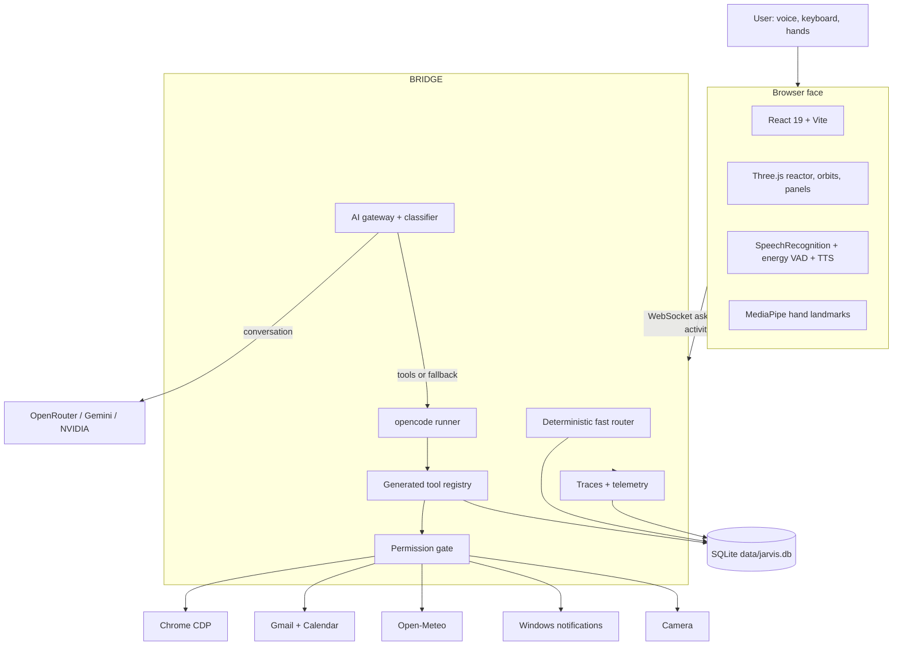
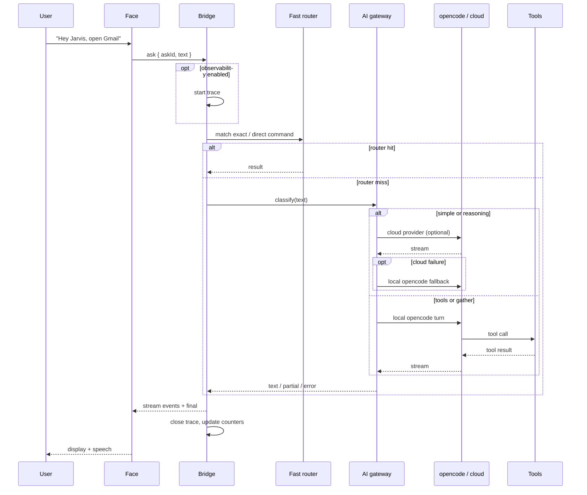

# Architecture

This document describes the JARVIS runtime as it exists in the repository. It
separates implemented behavior from designed-but-not-shipped work, and it names
the security boundaries that make a local assistant defensible.

- Runtime: Node.js 20+ ESM bridge, React/Vite browser face, SQLite data.
- Default brain: `opencode run --format json`, model `opencode/big-pickle`.
- Transport: WebSocket and HTTP on loopback port `8787`.
- Data: `data/jarvis.db`, WAL mode, four ordered migrations.
- Cloud: optional and free-first; the default configuration spends nothing.

See [installation.md](installation.md) for setup and [SECURITY.md](../SECURITY.md)
for the threat model and disclosure process.

---

## 1. Purpose and boundaries

JARVIS is a single-user, local-first assistant. The browser is the interface and
the Node bridge is the trusted process. The bridge owns:

- the WebSocket turn lifecycle;
- the deterministic command router;
- the model gateway and provider policy;
- the permission gate;
- the tool registry and generated opencode tools;
- SQLite persistence and observability.

The bridge is not a multi-tenant server. It binds to loopback and assumes the
machine and the user's browser profile are trusted. It is not designed to be
exposed to a LAN, a container network, or the public internet.

---

## 2. Runtime topology

| Process | Entry point | Default address | Responsibility |
|---|---|---|---|
| Face | Vite dev server | `http://localhost:5173` | React UI, Three.js HUD, voice capture, gesture tracking, bridge client |
| Bridge | `bridge/server.mjs` | `ws://127.0.0.1:8787` and `http://127.0.0.1:8787` | Turns, routing, models, tools, permissions, state |
| Data | `data/jarvis.db` | local file | Preferences, memory, projects, tasks, notifications, tabs, traces |
| Browser adapter | `bridge/chrome-cdp.mjs` | CDP, default `9333` (`JARVIS_CHROME_PORT`) | Navigate, read, act, screenshot |
| opencode turn | `bridge/runner.mjs` | child process | Local tool-using brain |
| Google APIs | `bridge/auth.mjs`, `gmail.mjs`, `calendar.mjs` | HTTPS | Opt-in Gmail and Calendar |
| Weather | `bridge/weather.mjs` | Open-Meteo HTTPS | Keyless forecast and geocoding |
| Notifications | `bridge/notifications.mjs` | Windows NotifyIcon | Native reminder balloons |

`npm start` launches the bridge and the Vite face as children of
`scripts/start.mjs`. `npm run start:detached -- --writes` launches the same pair
in the background, waits for health, and returns. The Windows launchers use the
same start path.



---

## 3. Turn lifecycle

Every browser `ask` frame enters the bridge with an `askId`, text, and an
optional interaction mode. When observability is enabled, the bridge opens a
trace; it resolves the route and streams events back to the page. The frontend
renders text deltas and speaks the final answer.



The browser can send `cancel` for the active `askId`; the bridge aborts the
provider request or kills the opencode process tree. A cancelled turn is still
traced with a terminal status.

---

## 4. Routing

Routing is intentionally ordered. A more expensive path is never tried before a
cheaper one that can answer.

| Level | Component | Input | Output | Model call |
|---|---|---|---|---|
| 1 | `bridge/router.mjs` | Exact browser, tab, scroll, clock, weather, open-site, state commands | Direct result | No |
| 2 | `bridge/router.mjs` | Reminders, notes, preferences, project memory, Gmail reads, calendar reads | Service result | No |
| 3 | `bridge/ai.mjs` + `bridge/runner.mjs` | Tool-shaped requests: Gmail, Calendar, memory writes, HUD, camera, browser actions | Tool-using turn | Local opencode |
| 4 | `bridge/ai.mjs` | Ordinary conversation and reasoning | Streamed answer | Cloud if configured, else local |

The classifier returns one of `simple`, `reasoning`, `gather`, or `tools`.
`gather` is used when a request needs both mail and calendar; the bridge fetches
both concurrently and hands the retrieved data to the model. Effectful wording
(`send`, `forward`, `delete`) disqualifies `gather`, so a write cannot hide in a
summarization path.

The fast router is deterministic. It does not ask a model to interpret a command
that it can match safely. This is both a latency decision and a safety decision:
the shortest path is also the easiest path to audit.

---

## 5. Local brain and generated tools

`bridge/runner.mjs` spawns:

```text
opencode run --format json -m <model> [-s <session>] [--variant <effort>]
```

The composed prompt is written to stdin, not argv. On Windows the command line
has a hard length ceiling, and a multi-kilobyte turn in argv fails with a silent
exit. Stdin has no such ceiling.

The bridge normalizes opencode JSON events into the stream contract the rest of
the server already understands. A session id is captured from the stream and
reused for conversational continuity. Cancellation uses `taskkill /T /F` on
Windows so a child Bash process cannot keep running after the turn is abandoned.

### Tool generation

At boot, `bridge/hudtools.mjs` writes eleven opencode custom-tool servers into a
dedicated runtime directory (`bridge/.oc/tools` by default). The generated files
are derived artifacts and are ignored by Git. Each tool posts its arguments to
the bridge's `/rpc/hud` endpoint with a per-process token. The bridge runs the
real handler against live state and returns the result to the model.

| Server | Representative tools | Domain |
|---|---|---|
| `jarvis` | `display`, `blade` | HUD panels and blades |
| `jarvis_ui` | `ui_theme`, `ui_screen`, `ui_effect`, `ui_orbit`, `ui_reactor`, `ui_chrome`, `ui_reset` | Visual control |
| `jarvis_chrome` | `chrome_navigate`, `chrome_read_page`, `chrome_click`, `chrome_type`, `chrome_tabs`, `chrome_screenshot` | Browser |
| `jarvis_eyes` | `look`, `watch` | Camera |
| `jarvis_weather` | `weather_forecast` | Weather |
| `jarvis_prefs` | `preferences_set`, `preferences_list`, `preferences_remove` | Preferences |
| `jarvis_notify` | `notify_schedule`, `notify_list`, `notify_cancel`, `notify_now` | Notifications |
| `jarvis_gmail` | `gmail_status`, `gmail_list`, `gmail_search`, `gmail_read`, `gmail_send` | Gmail |
| `jarvis_calendar` | `calendar_status`, `calendar_list`, `calendar_add`, `calendar_remove` | Calendar |
| `jarvis_memory` | `memory_save`, `memory_search`, `project_save`, `task_create` | Memory and projects |
| `jarvis_systems` | `services_status` | Health snapshot |

The generated tools are not a second implementation. They are thin RPC clients
for handlers in the bridge modules, so the permission gate sees every call in
one place.

---

## 6. AI gateway

`bridge/ai.mjs` and `bridge/providers.mjs` implement a provider-independent
gateway.

### Provider order

`AI_PROVIDER=auto` tries OpenRouter, then Gemini, then NVIDIA NIM, depending on
which keys and models are configured. A provider can be pinned by name. `none`
disables cloud conversation.

### Free-only policy

`AI_BILLING_MODE=free_only` is the default. A model is eligible only when:

- its id ends in `:free`;
- it is `openrouter/free`;
- it is listed in `AI_FREE_MODELS`; or
- for NVIDIA only, `NVIDIA_FREE=1` declares the endpoint free.

An exhausted free tier does not silently become a paid request. Standard billing
must be selected deliberately.

### Failure behavior

- Each attempt is bounded by `AI_TIMEOUT_MS` or `AI_REASONING_TIMEOUT_MS`.
- Timeout failover tries the next configured provider.
- A provider that returns empty text enters a temporary cooldown.
- Partial replies are never replayed.
- Cloud failure falls back to the local brain when `AI_FALLBACK=opencode`.
- Errors are categorized (`auth`, `quota`, `rate`, `timeout`, `unavailable`,
  `aborted`) and redacted before they reach the page or the trace.

### Privacy

Cloud turns do not carry preferences or retrieved mail/calendar text unless
`AI_CLOUD_DATA=1`. Local tools still run locally. Provider keys never leave the
bridge, and the status endpoint reports whether a provider is configured without
returning the key.

### OmniRoute

`bridge/omniroute.mjs` is an isolated, loopback-only adapter for a local
OpenAI-compatible router. It is disabled by default and is not in the cloud
chain. It validates the host, port, path, model, and allowlist, and rejects
`auto` ids, wildcards, query strings, and unapproved models. A separate canary
path is opt-in and uses one fixed synthetic prompt.

---

## 7. Frontend

The face is a React 19 + Vite 8 application with a Three.js scene.

- **Boot sequence** runs a four-beat ignition before the HUD becomes interactive.
- **Reactor and orbits** are custom GLSL and instanced geometry, not a video.
- **Panels and blades** render model-authored content. HTML is sanitized with
  DOMPurify, a class allowlist, and a strict CSP.
- **Voice** combines browser `SpeechRecognition` for the wake phrase with a
  local energy VAD for speech boundaries and barge-in. An echo guard prevents
  the assistant's own voice from re-triggering the recognizer.
- **Speech output** degrades through ElevenLabs, Kokoro, and the browser's
  `speechSynthesis`.
- **Hand tracking** uses MediaPipe Tasks Vision. The WASM runtime is copied from
  `node_modules` into `public/mediapipe` at start, so executable runtime bytes
  come from the pinned dependency rather than a live CDN.
- **Bridge client** sends `ask`, `cancel`, and activity frames over WebSocket,
  and receives stream, tool, panel, and activity events.

The HUD is a real control surface. The model can change themes, screens,
effects, reactors, and orbits through generated tools; those changes are still
validated by the frontend.

---

## 8. Data model

The bridge opens `data/jarvis.db` (override with `JARVIS_DB_PATH`), enables WAL,
and applies migrations tracked by `PRAGMA user_version`. There are four
migrations. Migrations are append-only; they are never renumbered.

| Table | Purpose | Notes |
|---|---|---|
| `preferences` | Standing preferences by key | Unique key, category, updated timestamp |
| `memory` | Facts and notes | Category, importance, source |
| `projects` | Project registry | Name, status, technologies, priority |
| `project_tasks` | Tasks per project | Status, priority, notes, completion time |
| `command_history` | Turn outcomes | Intent, result summary, success, timing; raw text is not persisted in the privacy path |
| `notifications` | Reminder queue | Scheduled time, pending/sent status |
| `app_shortcuts` | Named shortcuts | URL or action, aliases |
| `performance_logs` | Voice and turn timings | Speech, routing, MCP, browser, AI, TTS, total |
| `browser_tabs` | Known tab state | Target id, title, URL, active flag |
| `traces` | One row per turn | Route, model, provider, status, duration, redacted metadata |
| `trace_steps` | Ordered trace events | Component, operation, status, duration, redacted metadata |
| `telemetry_counters` | Daily aggregates | Component, operation, route, status, count, min/max/total ms |

Memory and project search currently use `LIKE` ranking. FTS5/BM25 retrieval and
hybrid ranking are designed but not shipped. There is no trace FTS table yet.

The database is personal data. It is git-ignored and must never be committed.

---

## 9. Observability

Observability is local and metadata-only.

- `JARVIS_OBSERVABILITY=1` writes turn traces and steps.
- `JARVIS_LOCAL_TELEMETRY=1` (default) writes aggregate counters.
- `JARVIS_TRACE_CONTENT=0` is the default and is the only supported Phase 1
  setting. Prompts, replies, tool payloads, and secrets are not stored.
- `JARVIS_TRACE_RETENTION_DAYS=30` prunes old traces at boot.
- Metadata passes through redaction before insertion.
- `/systems` combines service health, model/provider status, browser state,
  Google connection state, gesture runtime, and recent performance.

This answers questions such as “which route handled that turn?”, “how long did
the model take?”, and “did the browser adapter fail?” without turning the
assistant into a conversation archive.

---

## 10. Security model

The full threat model and reporting process are in [SECURITY.md](../SECURITY.md).
The architecture-level controls are:

| Boundary | Control |
|---|---|
| Network | Bridge binds to `127.0.0.1`. Origin allowlist; no-origin clients rejected by default. |
| Files | `/file`, `/img`, and `/media` validate scheme, confine paths, resolve real paths, and refuse private/loopback addresses. |
| Tools | Default-deny for effectful tools. `JARVIS_ALLOW_WRITES=1` is required for sends, mutations, shell/file effects, and browser actions. |
| Destructive actions | `calendar_remove`, `preferences_remove`, `chrome_close_tab`, `memory_delete`, `project_delete`, and `task_delete` also require spoken confirmation. |
| Rendered model output | DOMPurify, class allowlist, strict CSP. |
| Secrets | Server-side only. `.env`, `jarvis-secrets.cmd`, `bridge/.oc/auth/`, and `data/` are git-ignored. |
| Cloud context | Off by default via `AI_CLOUD_DATA=0`. |
| Logs and traces | Redaction; metadata only by default; no prompts or replies. |
| Prompt injection | Retrieved web/mail/calendar content is treated as untrusted data, not instructions; effectful calls still cross the gate. |

The permission gate is not a sandbox. When writes are enabled, the model can
drive the user's browser and Google account within the scopes the user granted.
Enable writes only when that is the intended mode.

---

## 11. Failure and degradation

| Failure | Behavior |
|---|---|
| Cloud provider down or times out | Try the next provider, then fall back to local opencode if configured. |
| opencode missing | The turn fails with a visible error; the router and local services still work. |
| Google not connected | Gmail/Calendar tools return a “not connected” status; the rest of JARVIS continues. |
| Chrome unreachable | Browser tools report the adapter state; other tools and conversation continue. |
| Non-Windows host | Native notifications fall back to a log line; the rest is cross-platform. |
| Telemetry write failure | Observability is best-effort and must not fail a turn. |
| Database newer than the build | The bridge refuses to run rather than guess at an unknown schema. |
| Microphone blocked | Voice stays offline; keyboard input and the HUD still work. |

---

## 12. Extension points

- **New deterministic command**: add a matcher in `bridge/router.mjs` and a test
  in the existing check scripts.
- **New provider**: add an adapter in `bridge/providers.mjs` and honor the same
  free-only, timeout, redaction, and cooldown contract.
- **New tool**: add the handler to the owning bridge module, register it in
  `bridge/hudtools.mjs`, and classify it as read, write, or destructive in the
  gate.
- **New table**: append a migration in `bridge/db.mjs`; never edit an existing
  migration.
- **New HUD panel**: add a renderer under `src/ui/` and sanitize the model-facing
  payload.

---

## 13. Known limits

- Memory retrieval is `LIKE`-based, not FTS5/BM25.
- No CPU, RAM, disk, or battery telemetry; `systems` is service-level.
- Wake word uses browser `SpeechRecognition`; Porcupine is present but not wired
  into the wake path.
- No phone-control bridge and no built-in image generation in the current tree.
- No committed screenshots yet; the README uses a labeled placeholder.
- Windows is the first-class platform for launchers, notifications, and the
  unattended Chrome flow.
- Single-user only. Do not expose the bridge to a network.
